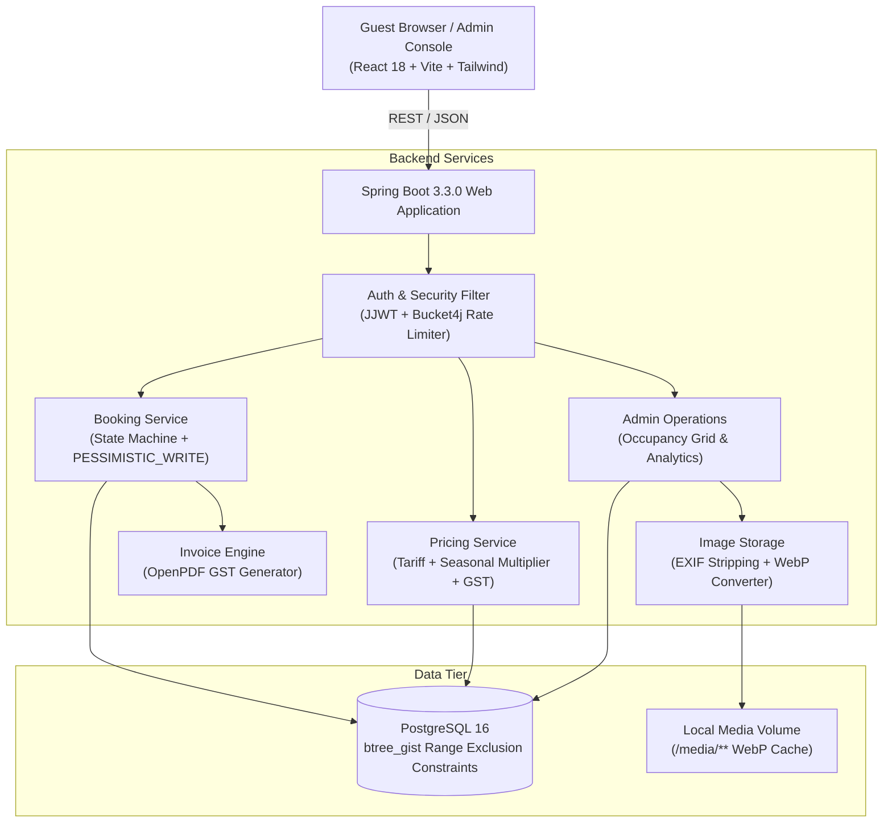
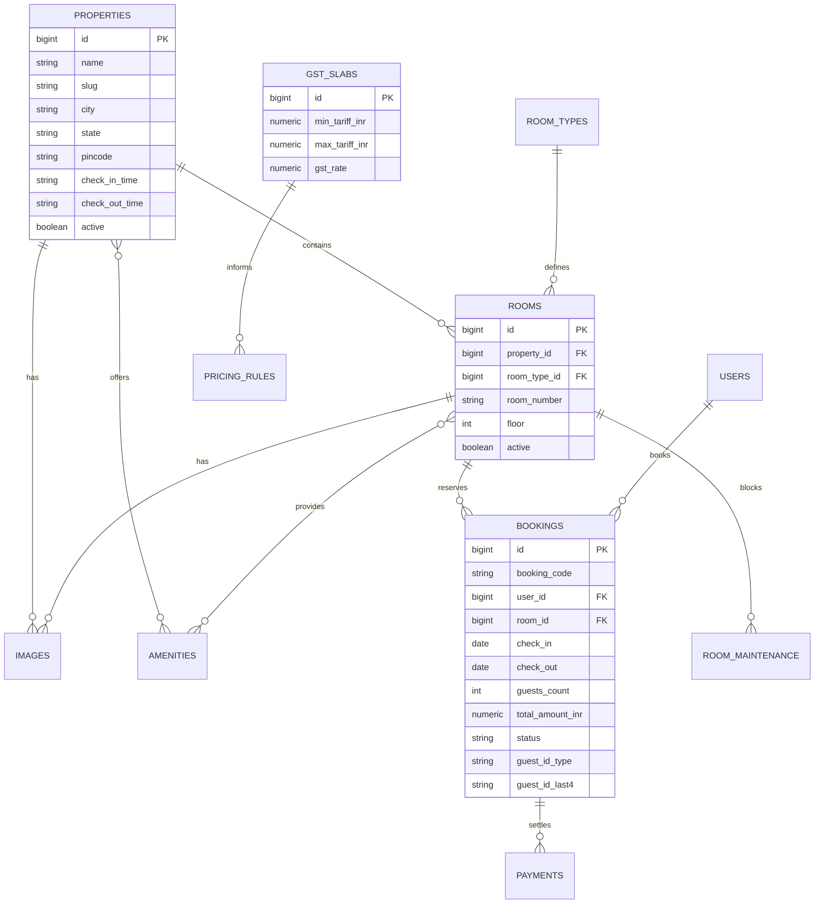

# StayKart

Hotel booking web application tailored for Indian hospitality, featuring transparent GST invoicing, seasonal pricing, pessimistic concurrency locking, and an operations dashboard.

---

## System Architecture



---

## Entity Relationship Overview



---

## Quick Setup (3 Commands)

### Prerequisites
- Java 17 (JDK)
- Node.js 20+
- Docker and Docker Compose

### Step 1: Start PostgreSQL Database
```bash
docker compose up -d db
```

### Step 2: Run Spring Boot Backend
```bash
# On Linux/macOS:
./mvnw spring-boot:run

# On Windows:
.\mvnw.cmd spring-boot:run
```
The backend initializes the database schema, runs Flyway migrations, and synchronizes seed images on port `8080`.

### Step 3: Run React Frontend
```bash
cd frontend
npm install
npm run dev
```
Open `http://localhost:5173` in your browser.

---

## Demo Accounts

| Role | Email | Password | Access Area |
| :--- | :--- | :--- | :--- |
| **Guest** | `guest1@example.com` | `Guest@123` | Room search, bookings, payment, PDF invoice download |
| **Administrator** | `admin@staykart.in` | `[Configured in .env / ask the author]` | Operational dashboard, occupancy calendar, inventory, pricing rules |

---

## Core Domain Rules

1. **Indian Currency & Rounding:**
   - All amounts are stored strictly as `NUMERIC(12,2)` in PostgreSQL and `BigDecimal` in Java.
   - User interfaces format currency using the Indian numbering system (`₹1,25,000.00` and `₹4,500`).

2. **Half-Open Date Semantics `[checkIn, checkOut)`:**
   - Check-in day is inclusive; check-out day is exclusive. A reservation ending on 10 November does not conflict with one starting on 10 November.

3. **Concurrency & Double-Booking Prevention:**
   - Double-booking is prohibited at two distinct application layers:
     - **Database Layer:** PostgreSQL `EXCLUDE USING gist (room_id WITH =, daterange(check_in, check_out, '[)') WITH &&)` constraint blocks overlapping dates at the storage level.
     - **Service Layer:** `RoomRepository.findByIdWithLock(roomId)` applies a `PESSIMISTIC_WRITE` lock within an isolated database transaction, queuing concurrent reservation attempts.

4. **Dynamic Indian GST Slabs:**
   - Applied per-night room tariff from the `gst_slabs` table:
     - Up to ₹1,000: **0% GST**
     - ₹1,001 to ₹7,500: **5% GST** (2.5% CGST + 2.5% SGST)
     - Above ₹7,500: **18% GST** (9.0% CGST + 9.0% SGST)
   - Every invoice displays an exact 50/50 split between Central GST (CGST) and State GST (SGST).

5. **Indian Guest Verification:**
   - Accepts Aadhaar, Passport, Driving Licence, or Voter ID. Only the ID proof type and last 4 digits are persisted.

---

## Architectural Decisions & Trade-Offs

- **Pessimistic Locking vs Optimistic Locking:**
  - Optimistic locking (`@Version`) fails late during high-concurrency checkout contention (e.g. festival flash sales or wedding season spikes), forcing users to repeat payment.
  - Pessimistic write locking on `Room` acquires an exclusive row lock at the point of booking creation, guaranteeing that holds do not collide.
- **OpenPDF vs iText:**
  - OpenPDF uses LGPL/MPL licensing, allowing commercial deployment without the strict copyleft requirements of iText 7 (AGPL).
- **WebP Image Pipeline:**
  - Seed and admin-uploaded photos are decoded, stripped of EXIF and GPS metadata, and re-encoded into WebP with three size variants (thumbnail 400px, card 800px, and large 1600px).
- **Zero External Network Dependencies:**
  - All property, destination, and room photographs are stored locally and served via `/media/**` endpoints, ensuring offline reliability during live evaluations.

---

## Image Assets & One-Time Download Helper

- **Self-Contained Local Assets:** All destination and hotel photography is pre-bundled in `frontend/public/images/` and `backend/seed-images/properties/` and `backend/seed-images/rooms/`. You do not need an external internet connection to run the application locally or in production.
- **One-Time Helper Script (`scripts/download_images.mjs`):** This script serves as a developer utility used to initially pull authentic photography from Unsplash using `&fm=webp` format encoding. Running it downloads assets directly into the correct `backend/seed-images/properties/` directory structure and updates `CREDITS.md`.
- **Photo Credits:** Full photographer credits, Unsplash source links, and license statements are documented in [CREDITS.md](CREDITS.md).

---

## Testing

```bash
# Run backend test suite (35 unit and concurrency tests):
./mvnw test

# Run frontend test suite:
cd frontend && npm test

# Run full production build verification:
./mvnw clean verify
cd frontend && npm run build
```
